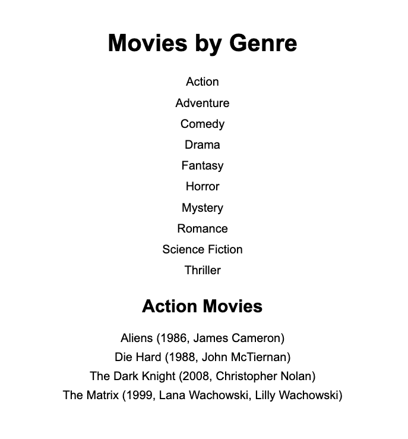
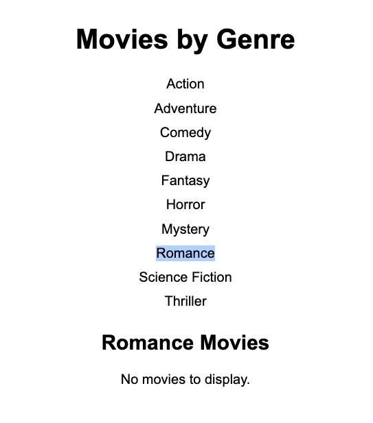
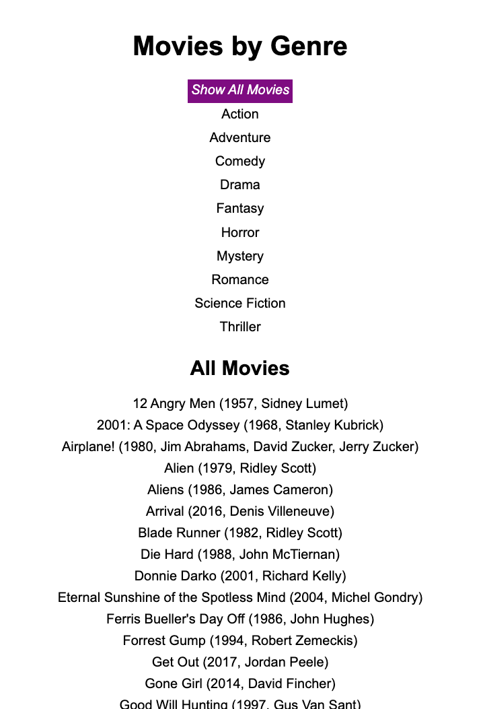

# React State & Event Management
## Practice 1

### Starter Code

To get you started:
- The boilerplate content has been removed
- Some minor CSS has been provided
- A `mock-data` directory has been provided with `genres.js` and `movies.js`

### Basic Solution

The expected basic solution should include:
- A `GenreList` component that displays a list of genres using the data found in `/src/mock-data/genres.js`
- A `MovieList` component that displays a list of movies using the data found in `/src/mock-data/movies.js`
- A state variable, `currentGenre`, to track the selected genre
- The ability to click on a genre to update the list of movies that match that genre only
- An alternate message if there are no movies to display for a selected genre

Example of basic solution with "Action" selected:

Example of basic solution with "Romance" selected:

### Bonus Solution

Bonus extensions, if completed, should add:
- The current genre being highlighted in `GenreList`
- The ability to display all movies

Example of extended solution with *"Show All Movies"* selected:

